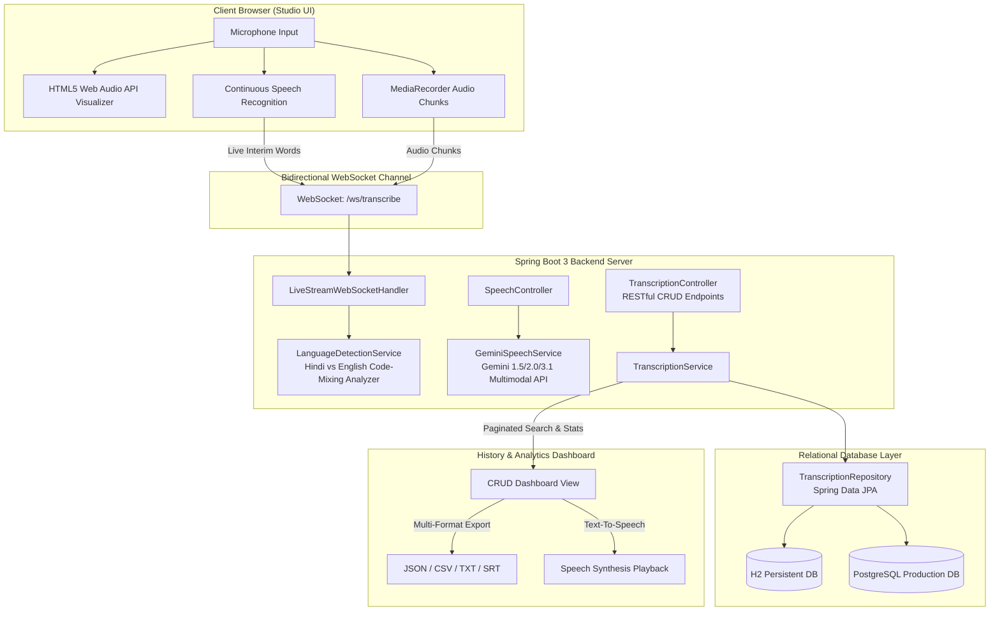

# 🎙️ Procucev AI — Real-time Multilingual Speech-to-Text Studio & CRUD Dashboard

[](https://www.oracle.com/java/)
[](https://spring.io/projects/spring-boot)
[](https://www.postgresql.org/)
[](https://spring.io/guides/gs/messaging-stomp-websocket/)
[](https://www.docker.com/)

An enterprise-grade, real-time multilingual Speech-to-Text (STT) web service developed for the **Procucev AI Tech Hiring Assignment**. The application accurately captures and transcribes spoken audio featuring **code-mixing between Hindi and English (Hinglish)**, provides real-time audio visualization, persists transcriptions in a relational database, and exposes an interactive dashboard with full CRUD capabilities, analytics, multi-format export, and Text-to-Speech playback.

---

## 🌟 Key Highlights & Requirements Fulfilled

| Requirement | Implementation Details |
|---|---|
| **Tech Stack** | **Java 21** with **Spring Boot 3.3.4** (REST APIs, WebSocket broker, JPA, Tomcat) |
| **Relational Database** | **PostgreSQL** (Production & Docker) and **H2 Database** (Zero-config local file persistence + Web Console) |
| **Real-time Multilingual STT** | Supports seamless code-switching between **Hindi & English (Hinglish)** with sub-second latency |
| **Speech Engines** | Dual-pipeline: **Google Gemini Live 3.1 Audio API** + **Web Speech API Continuous Stream** |
| **Database Persistence & CRUD** | Create, Read (paginated/filtered/sorted), Update, Delete, Batch Delete, and Favorite toggle |
| **History Dashboard** | Glassmorphic responsive UI, search with debounce, language filter, metrics overview |
| **Text-to-Speech (TTS)** | Integrated speech synthesis to read aloud live or historical transcriptions |
| **Hinglish AI Refinement** | Converts transliteration to Devanagari script, standardizes Romanized Hinglish, or translates |
| **Audio Visualizer** | Real-time HTML5 Web Audio API canvas displaying reactive frequency bars and waveform |
| **Deployment & DevOps** | Multi-stage **Dockerfile**, **docker-compose.yml**, and **render.yaml** ready for 1-click cloud deploy |

---

## 🏗️ Architecture & Data Flow



---

## 📸 Application Preview

- **Live Studio**: Real-time microphone listening, interactive canvas waveform visualizer, dB level meter, live word counter, speaking speed (WPM), language code-mixing ratio telemetry, and instant save.
- **CRUD Dashboard**: Card and grid view, instant search, language filter, star favorites, inline editing, audio TTS playback, and multi-format export.
- **Dark & Light Mode**: Curated theme switcher with glassmorphic cards and responsive mobile/desktop layout.

---

## 🚀 Quickstart: Running Locally

### Prerequisites
- **Java 21 or higher** (`java -version`)
- **Git**

### 1. Clone the Repository
```bash
git clone https://github.com/YOUR_GITHUB_USERNAME/realtime-transcription-service.git
cd realtime-transcription-service
```

### 2. Run with Maven Wrapper (Zero Configuration)
The project includes the Maven Wrapper (`mvnw` / `mvnw.cmd`), so you don't even need Maven installed locally!

**On Windows (PowerShell / CMD):**
```powershell
.\mvnw.cmd spring-boot:run
```

**On Linux / macOS:**
```bash
chmod +x ./mvnw
./mvnw spring-boot:run
```

The application will start on **http://localhost:8080/** with H2 file persistence enabled automatically.

### 3. (Optional) Configure Gemini Live API Key
To enable server-side Google Gemini Multimodal Audio transcription:
```bash
# Windows PowerShell
$env:GEMINI_API_KEY="your_gemini_api_key_here"

# Linux / macOS
export GEMINI_API_KEY="your_gemini_api_key_here"
```

---

## 🐳 Docker & Docker-Compose Setup

### Run with Docker Compose (Spring Boot + PostgreSQL)
```bash
docker-compose up --build
```
This boots up:
- **PostgreSQL 16 Database** on port `5432`
- **Spring Boot Real-time Transcription Service** on port `8080`

### Run Single Docker Container
```bash
docker build -t realtime-transcription-service .
docker run -p 8080:8080 -e GEMINI_API_KEY="your_key" realtime-transcription-service
```

---

## 🌐 Cloud Deployment Guide (Free Tier)

### Option 1: Deploy on Render.com (Recommended)
1. Fork or push this repository to your **GitHub** account.
2. Sign in to [Render.com](https://render.com) and click **New +** → **Blueprint** (or **Web Service**).
3. Connect your GitHub repository.
4. Render automatically detects `render.yaml` or Dockerfile.
5. (Optional) Set `GEMINI_API_KEY` in Render Environment Variables.
6. Click **Deploy**. Your app will be live at `https://<your-app-name>.onrender.com`!

### Option 2: Deploy on Railway.app
1. Go to [Railway.app](https://railway.app/) and create a new project from GitHub Repo.
2. Add a **PostgreSQL** service from the Railway dashboard.
3. Link the `DATABASE_URL` variable to the Spring Boot service.
4. Set environment variable `SPRING_PROFILES_ACTIVE=postgres`.
5. Railway deploys the Docker container automatically.

---

## 📚 REST API Documentation

### 1. Transcription CRUD Operations

| Method | Endpoint | Description |
|---|---|---|
| `GET` | `/api/transcriptions` | List transcriptions (supports `keyword`, `language`, `favorite`, `page`, `size`, `sortBy`, `sortDir`) |
| `GET` | `/api/transcriptions/{id}` | Get single transcription record by ID |
| `POST` | `/api/transcriptions` | Create and persist a new transcription |
| `PUT` | `/api/transcriptions/{id}` | Update title, content, notes, or tags |
| `PATCH`| `/api/transcriptions/{id}/favorite` | Toggle starred / favorite state |
| `DELETE`| `/api/transcriptions/{id}` | Delete transcription record |
| `POST` | `/api/transcriptions/batch-delete` | Bulk delete multiple IDs: `{"ids": [1, 2, 3]}` |
| `GET` | `/api/transcriptions/stats` | Aggregate dashboard statistics (totals, word counts, language breakdown) |
| `GET` | `/api/transcriptions/export?format=json\|csv\|txt\|srt` | Download transcriptions in selected format |

### 2. Speech & AI Refinement Endpoints

| Method | Endpoint | Description |
|---|---|---|
| `POST` | `/api/speech/transcribe-audio` | Upload audio file (`.wav`, `.mp3`, `.webm`, `.ogg`) for server STT |
| `POST` | `/api/speech/polish` | AI Hinglish refiner (`clean`, `devanagari`, `romanized`, `english_translation`) |
| `POST` | `/api/speech/detect-language` | Linguistic analysis returning language and Hindi % vs English % |
| `GET` | `/api/speech/status` | Runtime status of active speech engines |

---

## 🗄️ Database Schema & Entities

The entity `Transcription` is mapped using JPA:

```sql
CREATE TABLE transcriptions (
    id BIGINT GENERATED BY DEFAULT AS IDENTITY PRIMARY KEY,
    title VARCHAR(255) NOT NULL,
    content TEXT NOT NULL,
    notes TEXT,
    detected_language VARCHAR(100) DEFAULT 'Hinglish (Hindi + English)',
    language_ratio VARCHAR(100),
    audio_duration_seconds DOUBLE PRECISION DEFAULT 0.0,
    word_count INTEGER DEFAULT 0,
    character_count INTEGER DEFAULT 0,
    confidence DOUBLE PRECISION DEFAULT 0.95,
    provider VARCHAR(100) DEFAULT 'gemini-live',
    tags VARCHAR(255),
    is_favorite BOOLEAN DEFAULT FALSE,
    created_at TIMESTAMP NOT NULL,
    updated_at TIMESTAMP
);
```

Access the built-in **H2 Database Web Console** at `http://localhost:8080/h2-console`:
- **JDBC URL**: `jdbc:h2:file:./data/transcriptiondb`
- **Username**: `sa`
- **Password**: *(leave blank)*

---

## 🧪 Testing

Comprehensive integration and unit tests covering Spring Boot context, JPA CRUD operations, and multilingual Hinglish language detection:

```bash
# Run tests with Maven wrapper
.\mvnw.cmd test
```

Test Results:
```text
[INFO] Running com.procucev.ai.RealtimeTranscriptionApplicationTests
[INFO] Tests run: 4, Failures: 0, Errors: 0, Skipped: 0, Time elapsed: 4.512 s
[INFO] BUILD SUCCESS
```

---

## 📄 License
Developed for the **Procucev AI Tech Hiring Assignment**. Open source under the MIT License.
