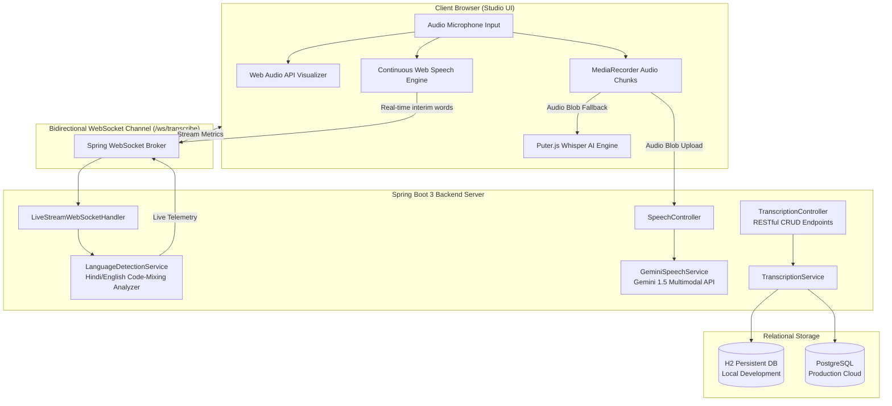
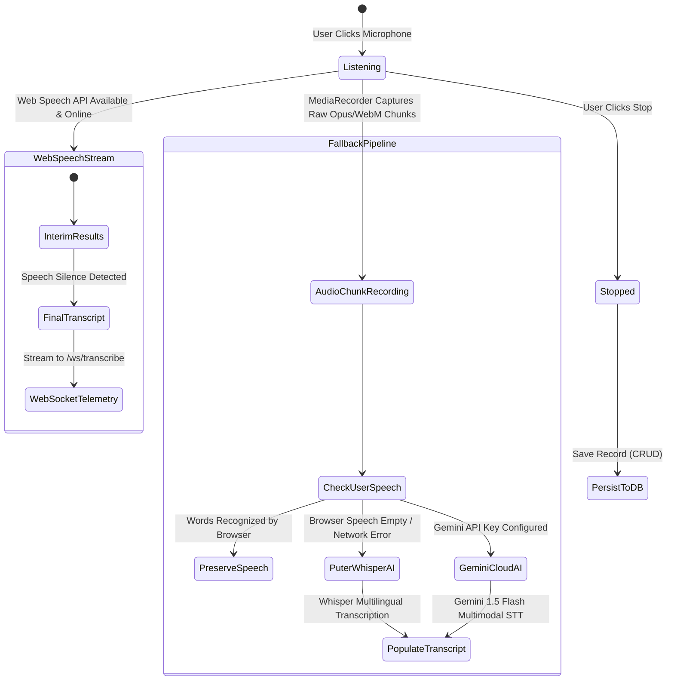

# 🏗️ Procucev AI — System Architecture & Design Specification

This document provides a comprehensive technical overview of the **Procucev AI Real-time Multilingual Speech-to-Text Studio**, including data flow pipelines, state machines, WebSocket protocols, and database schemas.

---

## 1. High-Level Architecture Overview



---

## 2. Audio Streaming & Multilingual Fallback State Machine

The application incorporates a **3-tier resilient audio processing pipeline** to guarantee continuous transcription across all devices, browsers, and network environments:



---

## 3. WebSocket Protocol Specification

### Connection URL
- **Local:** `ws://localhost:8080/ws/transcribe`
- **Production (TLS):** `wss://<domain>/ws/transcribe`

### Client-to-Server Message Format
```json
{
  "type": "ANALYZE_STREAM",
  "text": "Aaj hum log project deploy karenge Render ya Railway par with PostgreSQL database"
}
```

### Server-to-Client Telemetry Response
```json
{
  "type": "STREAM_METRICS",
  "primaryLanguage": "Hinglish (Hindi + English)",
  "languageRatio": "Hindi: 42% | English: 58%",
  "wordCount": 13,
  "confidence": 0.95,
  "timestamp": 1729505488000
}
```

---

## 4. Relational Database Schema (JPA)

```sql
CREATE TABLE transcriptions (
    id BIGINT GENERATED BY DEFAULT AS IDENTITY PRIMARY KEY,
    title VARCHAR(255) NOT NULL,
    content TEXT NOT NULL,
    notes TEXT,
    detected_language VARCHAR(100),
    language_ratio VARCHAR(100),
    audio_duration_seconds DOUBLE PRECISION DEFAULT 0.0,
    word_count INT DEFAULT 0,
    character_count INT DEFAULT 0,
    confidence DOUBLE PRECISION DEFAULT 0.95,
    provider VARCHAR(100) DEFAULT 'browser-live-speech',
    tags VARCHAR(255),
    is_favorite BOOLEAN DEFAULT FALSE,
    created_at TIMESTAMP WITHOUT TIME ZONE NOT NULL,
    updated_at TIMESTAMP WITHOUT TIME ZONE NOT NULL
);

CREATE INDEX idx_transcriptions_created_at ON transcriptions(created_at DESC);
CREATE INDEX idx_transcriptions_language ON transcriptions(detected_language);
CREATE INDEX idx_transcriptions_favorite ON transcriptions(is_favorite);
```

---

## 5. Security & Deployment Architecture
- **Non-root container user:** Runs under `appuser` (UID 1000) for security hardening.
- **Port auto-binding:** Compatible with cloud standard `$PORT` dynamic injection (Render / Railway).
- **Zero-leaks policy:** API keys are never stored in plain text repository files and accept dynamic header injection (`X-Gemini-API-Key`).
